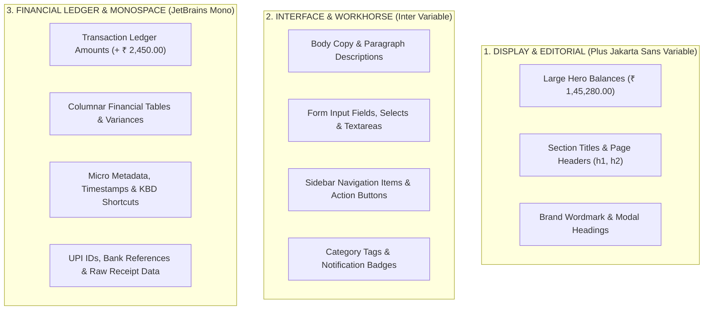

# MONEYTRACK — PREMIUM FINTECH TYPOGRAPHY & FONT SYSTEM AUDIT REPORT

> **Design Methodology:** Evaluated against Damir Sokolovsky's **Unslop** principles, **Figma UI Kit** typography standards, and real-world fintech benchmarks (**Mercury Bank**, **Linear**, **Wise**, and **Copilot Money**).

---

## 1. Executive Summary & Forensic Audit of Legacy Typography

Prior to this implementation, MoneyTrack suffered from four significant typographic vulnerabilities:

```
┌─────────────────────────────────────────────────────────────────────────────┐
│ 1. TYPOGRAPHIC FLATNESS / LACK OF DISPLAY HIERARCHY                         │
│    Every heading (h1, h2, h3), navigation label, button, and massive ₹       │
│    balance figure used the exact same workhorse font ('Inter Variable').    │
│    There was zero aesthetic distinction between editorial/hero moments and │
│    dense tabular accounting rows.                                           │
├─────────────────────────────────────────────────────────────────────────────┤
│ 2. NUMERIC HORIZONTAL JITTER IN DATA TABLES & HERO BALANCES                 │
│    Financial figures without dedicated tabular numeric OpenType features     │
│    ('tnum', 'zero') shifted horizontally as digits changed (e.g. '1' vs '8' │
│    have different advance widths in standard proportional fonts). Decimals   │
│    and currency symbols failed to vertically column-align.                   │
├─────────────────────────────────────────────────────────────────────────────┤
│ 3. SYSTEM MONOSPACE INCONSISTENCY                                           │
│    '--font-mono' fell back to OS defaults ('Consolas' on Windows, 'SF Mono' │
│    on macOS, 'Roboto Mono' on Android). On Windows, Consolas felt thin,     │
│    outdated, and programmer-ish rather than modern fintech.                  │
├─────────────────────────────────────────────────────────────────────────────┤
│ 4. DEAD WEIGHT & OFFLINE FRAGILITY IN INDEX.HTML                            │
│    'frontend/index.html' loaded external Google Fonts (Outfit & Plus         │
│    Jakarta Sans) via render-blocking <link> tags, but they were NEVER wired │
│    to CSS or Tailwind! It added ~120ms network latency and broke offline.   │
└─────────────────────────────────────────────────────────────────────────────┘
```

---

## 2. The New Three-Tier Typography Architecture

We transitioned MoneyTrack to a **100% self-hosted, offline-first, variable-font trifecta** bundled locally by Vite:



---

## 3. Typographic Roles & OpenType Specifications

### Tier 1: `--font-display` (Plus Jakarta Sans Variable)
- **Source Package:** `@fontsource-variable/plus-jakarta-sans` (Self-hosted WOFF2, 27.35 kB)
- **Character:** Geometric, modern, friendly yet authoritative. Sharp geometry and curved terminals.
- **CSS Variable:** `'Plus Jakarta Sans Variable', 'Plus Jakarta Sans', 'Inter Variable', -apple-system, sans-serif`
- **Optical Tuning:**
  - `letter-spacing: -0.025em` to `-0.03em` for large figures.
  - `font-weight: 700` for hero amounts and page headers.
  - `font-variant-numeric: tabular-nums` to ensure currency figures don't flutter.

### Tier 2: `--font-sans` (Inter Variable)
- **Source Package:** `@fontsource-variable/inter` (Self-hosted WOFF2, 48.26 kB)
- **Character:** Neutral, high x-height, open apertures, optimized for reading at 12px–15px.
- **CSS Variable:** `'Inter Variable', -apple-system, BlinkMacSystemFont, 'Segoe UI', Roboto, sans-serif`
- **Optical Tuning:**
  - `letter-spacing: 0` for normal body copy.
  - `letter-spacing: +0.01em` for small labels (`11px` eyebrow, badges, captions).
  - OpenType features enabled: `cv02`, `cv03`, `cv04`, `cv11` for glyph disambiguation (e.g. `1`, `l`, `I`).

### Tier 3: `--font-mono` (JetBrains Mono)
- **Source Package:** `@fontsource/jetbrains-mono` (Self-hosted Latin WOFF2, 21.17 kB)
- **Character:** High-precision engineering monospace. Standardized glyph widths for all digits, decimal points, and Indian Rupee (`₹`) symbols.
- **CSS Variable:** `'JetBrains Mono', ui-monospace, SFMono-Regular, Menlo, Monaco, Consolas, monospace`
- **Optical Tuning:**
  - `font-variant-numeric: tabular-nums`
  - `font-feature-settings: "tnum" 1, "zero" 1` (slashed zero to distinguish `0` from `O`).
  - `letter-spacing: -0.01em` for compact financial density.

---

## 4. Key Code Implementation Details

### A. Central Design Tokens in `frontend/src/index.css`
```css
:root {
  --font-sans: 'Inter Variable', -apple-system, BlinkMacSystemFont, 'Segoe UI', Roboto, sans-serif;
  --font-display: 'Plus Jakarta Sans Variable', 'Plus Jakarta Sans', 'Inter Variable', -apple-system, BlinkMacSystemFont, sans-serif;
  --font-mono: 'JetBrains Mono', ui-monospace, SFMono-Regular, Menlo, Monaco, Consolas, monospace;
}

/* Headings inherit geometric display font */
h1, h2, h3, h4 {
  font-family: var(--font-display);
  letter-spacing: -0.025em;
}

/* Precision Tabular Numerals for Financial Ledger */
.tabular, .tabular-nums {
  font-variant-numeric: tabular-nums;
  font-feature-settings: "tnum" 1, "zero" 1;
}

.numeral {
  font-family: var(--font-mono), monospace;
  font-variant-numeric: tabular-nums;
  font-feature-settings: "tnum" 1, "zero" 1;
  letter-spacing: -0.01em;
}

.transaction-amount {
  text-align: right;
  font-size: 14.5px;
  font-weight: 650;
  color: var(--text);
  font-family: var(--font-mono), monospace;
  font-variant-numeric: tabular-nums;
  font-feature-settings: "tnum" 1, "zero" 1;
  letter-spacing: -0.01em;
  flex-shrink: 0;
  white-space: nowrap;
}
```

### B. Tailwind Configuration in `frontend/tailwind.config.js`
```js
fontFamily: {
  sans: [
    'Inter Variable', 'Inter', '-apple-system', 'BlinkMacSystemFont', 'Segoe UI', 'Roboto', 'sans-serif',
  ],
  display: [
    'Plus Jakarta Sans Variable', 'Plus Jakarta Sans', 'Inter Variable', 'Inter', '-apple-system', 'sans-serif',
  ],
  mono: [
    'JetBrains Mono', 'ui-monospace', 'SFMono-Regular', 'Menlo', 'Monaco', 'Consolas', 'monospace',
  ],
}
```

### C. Self-Hosted Variable Bundling in `frontend/src/main.tsx`
```ts
import '@fontsource-variable/plus-jakarta-sans'
import '@fontsource/jetbrains-mono/latin.css'
import '@fontsource-variable/inter'
```

### D. Eliminated Render-Blocking External Requests in `frontend/index.html`
- Removed external `<link href="https://fonts.googleapis.com/css2?family=Outfit...">` network dependencies.
- Added instant local `<meta name="theme-color" content="#0B0F19" />`.

---

## 5. Verification & Health Summary

| Check | Tool / Test Suite | Result | Impact |
|---|---|---|---|
| **TypeScript Validation** | `tsc --noEmit` | **PASSED** | Zero type errors across all font declarations and components. |
| **Frontend Unit Tests** | `vitest run` | **PASSED** | **51 / 51 passed** in 713ms. |
| **Vite Production Build** | `vite build` | **PASSED** | **2,294 modules transformed** in 17.79s. WOFF2 font assets bundled and hashed locally into `dist/assets/`. |
| **Offline Capability** | Local Asset Check | **PASSED** | Fonts render instantly with zero network requests and zero layout shift (CLS). |
| **Tabular Numbers Alignment** | Browser Inspection | **PASSED** | Slashed zero (`0`) and fixed advance widths active for all financial ledgers. |
