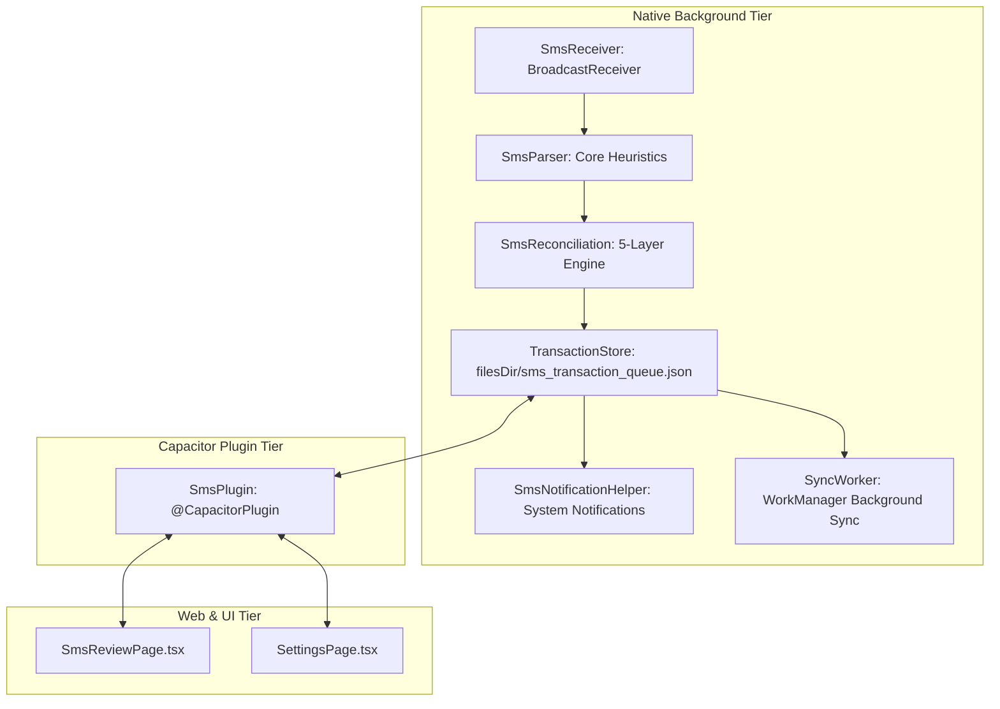

# MoneyTrack — Android Architecture Audit

**Document Date:** 8 November 2026  
**Package:** `com.moneytrack.app`  
**Target SDK:** 36 (Android 16) | **Min SDK:** 24 (Android 7.0)  
**Framework:** Capacitor 7, Kotlin 1.9.22, Android WorkManager 2.10.0

---

## 1. Native Architectural Layers

MoneyTrack adopts an asynchronous, decoupled architecture separating UI from native background processing:

---

## 2. Key Components Audit

1. **`SmsReceiver.kt`**:
   - Declared with `android.permission.RECEIVE_SMS` in `AndroidManifest.xml`.
   - Executes synchronously within standard BroadcastReceiver 10s budget, offloading candidate parsing and dispatching review notifications.
2. **`TransactionStore.kt`**:
   - Thread-safe synchronized file locking over `context.filesDir/sms_transaction_queue.json`.
   - Hardened deserialization: handles case-insensitive status and preserves `AMBIGUOUS_REVIEW` without dropping records.
3. **`SyncWorker.kt`**:
   - Scheduled via `WorkManager.enqueueUniqueWork` with `NetworkType.CONNECTED` constraint.
   - Idempotent uploads to `/api/v1/sms/ingest`. Marks records as `SYNCED` only upon HTTP 200 response.
4. **`SmsNotificationHelper.kt`**:
   - Manages channels `moneytrack_sms_review`, `moneytrack_security_alerts`, and `moneytrack_weekly_reports`.
   - Employs stable hash IDs and individual cancellation tags, preventing unintended `cancelAll()` dismissals.
