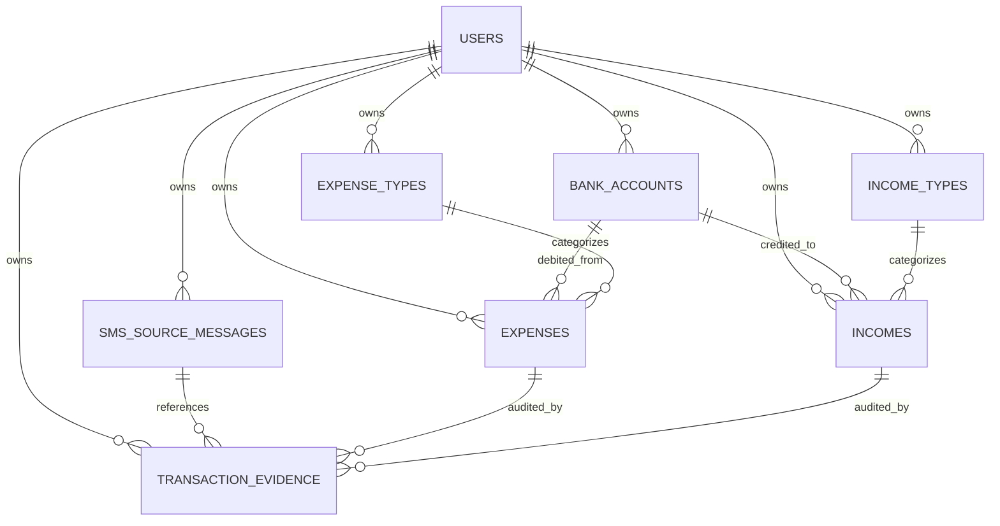

# MoneyTrack — Database Architecture

**Version:** 2.1.0  
**Date:** 8 November 2026  
**Architectural Scope:** Multi-Tenant Relational Schema, Double-Entry Ledger, Audit Evidence, and Constraints

---

## 1. Relational Entity Schema

MoneyTrack's data tier uses a multi-tenant relational schema supported on both SQLite (local development) and PostgreSQL 18 (production Neon):



### 1.1 Core Financial Tables
- **`users`**: Root tenant model.
  - Columns: `id` (PK), `email` (Unique), `hashed_password`, `full_name`, `is_active`, `is_superuser`, timestamps.
- **`expenses`**: Outflow records.
  - Columns: `id` (PK), `user_id` (FK `users.id`), `expense_type_id` (FK `expense_types.id`), `account_id` (FK `bank_accounts.id`), `amount_paise` (BigInteger > 0), `expense_date`, `note`, `payment_method`, `merchant`, `bank_reference`, `source`, `confidence`, timestamps.
  - Constraints: `ck_expenses_amount_positive`, `uq_expenses_user_id (user_id, id)`.
- **`incomes`**: Inflow records.
  - Columns: `id` (PK), `user_id` (FK `users.id`), `income_type_id` (FK `income_types.id`), `account_id` (FK `bank_accounts.id`), `amount_paise` (BigInteger > 0), `income_date`, `payer`, `description`, `payment_method`, `bank_reference`, `source`, `confidence`, `idempotency_key` (Unique), timestamps.
  - Constraints: `ck_incomes_amount_positive`, `uq_incomes_user_id (user_id, id)`.
- **`bank_accounts`**: Ledger account entities.
  - Columns: `id` (PK), `user_id` (FK `users.id`), `bank_name`, `account_name`, `account_type`, `account_number_mask`, `currency`, `opening_balance_paise`, `current_balance_paise`, `last_reported_balance_paise`, `last_reported_at`, `reconciliation_status`, timestamps.

---

## 2. Audit Evidence & Source Tracing

### 2.1 `sms_source_messages`
Stores immutable cryptographic records of incoming messages for provenance:
- `id` (PK)
- `user_id` (FK `users.id`, Index)
- `sender_id` (String 50, Index)
- `received_at_ms` (BigInteger, Index)
- `content_hash` (SHA-256 hex string, Unique per user)
- `classification` (Enum String: `BANK_DEBIT`, `BANK_CREDIT`, `UPI_DEBIT`, `RECHARGE`, `AMBIGUOUS_REVIEW`, `NON_FINANCIAL_SMS`)
- `parser_version` (String 20)
- `evidence_summary` (Text)
- `processing_status` (String 30: `PROCESSED`, `QUARANTINED`, `FAILED`)
- Constraints: `uq_sms_source_messages_user_id (user_id, id)`.

### 2.2 `transaction_evidence`
Junction table linking financial ledger items to raw message evidence:
- `id` (PK)
- `user_id` (FK `users.id`)
- `sms_message_id` (FK `sms_source_messages.id`)
- `expense_id` (FK `expenses.id`, Nullable)
- `income_id` (FK `incomes.id`, Nullable)
- `evidence_role` (String 30: `PRIMARY_NOTIFICATION`, `DUAL_NOTIFICATION`, `RECHARGE_MATCH`)
- `reconciliation_layer` (String 20: `LAYER_A`, `LAYER_B`, `LAYER_C`, `LAYER_D`, `LAYER_E`)
- `match_confidence` (String 20: `HIGH`, `MEDIUM`, `MANUAL`)
- `linked_at` (UTCDateTime)

### 2.3 Kernel-Enforced Constraints
1. **Target XOR Constraint**:
   ```sql
   CONSTRAINT ck_transaction_evidence_target CHECK (
       (expense_id IS NOT NULL AND income_id IS NULL) OR
       (expense_id IS NULL AND income_id IS NOT NULL)
   )
   ```
2. **Duplicate Linkage Prevention**:
   - `uq_evidence_sms_expense (sms_message_id, expense_id)`
   - `uq_evidence_sms_income (sms_message_id, income_id)`
3. **Composite Foreign Keys for Database-Enforced Tenant Isolation**:
   ```sql
   CONSTRAINT fk_evidence_user_expense FOREIGN KEY (user_id, expense_id) REFERENCES expenses (user_id, id) ON DELETE CASCADE
   CONSTRAINT fk_evidence_user_income FOREIGN KEY (user_id, income_id) REFERENCES incomes (user_id, id) ON DELETE CASCADE
   CONSTRAINT fk_evidence_user_sms FOREIGN KEY (user_id, sms_message_id) REFERENCES sms_source_messages (user_id, id) ON DELETE CASCADE
   ```
