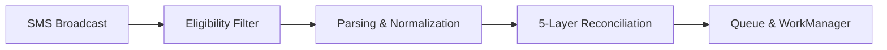

# MoneyTrack — SMS Intelligence & Reconciliation Engine Report

**Document Date:** 8 November 2026  
**Module Location:** `android/app/src/main/java/com/moneytrack/app/sms/`  
**Core Classes:** `SmsReceiver`, `SmsParser`, `SmsEligibility`, `SmsReconciliation`, `TransactionStore`, `SyncWorker`

---

## 1. Pipeline Stages

The SMS processing pipeline transitions messages through five sequential stages:

1. **Eligibility Filter (`SmsEligibility.kt`)**: Rejects OTPs, login verification codes, promo senders, and telecom quota alerts ("You have used 100% of your daily data quota").
2. **Parsing & Normalization (`SmsParser.kt`)**:
   - Cleans sender IDs (`AD-SDCCBL-S` -> `SDCCBL`).
   - Extracts amount in paise (e.g. `Rs 3,003.00` -> `300300L`).
   - Extracts masked account numbers (`*4375`, `XX8824`).
   - Extracts UTR / RRN references while preventing false masking of references containing `'X'` (e.g. `TXN98877`).
   - Extracts available balance (`Bal: INR 12,143.09` -> `1214309L`).
3. **5-Layer Reconciliation Engine (`SmsReconciliation.kt`)**:
   - **Layer A**: Exact SMS text hash matching.
   - **Layer B**: Matching UTR reference **with amount equality validation**.
   - **Layer C**: Intra-bank CBS/UPI dual-notification merge (30-minute window).
   - **Layer D**: Cross-source telecom recharge confirmation merge.
   - **Layer E**: Chronological balance progression delta validation.
4. **Durable Queue (`TransactionStore.kt`)**: Atomic persistence to `sms_transaction_queue.json`.
5. **WorkManager Sync (`SyncWorker.kt`)**: Network-constrained worker uploading candidates to `/api/v1/sms/ingest`.

---

## 2. Adversarial Test Coverage (22 Tests in `SmsReconciliationTest.kt`)

All 22 unit tests passed with 0 failures:
- 4 Core Layer Tests (Layer A, B, C, D).
- 10 Adversarial Duplicate & Fingerprinting Scenarios.
- 8 Specific Phase D Gate Scenarios:
  1. Two legitimate identical credits (`PASS`).
  2. One duplicate notification with updated balance (`PASS`).
  3. Out-of-order balance snapshots (`PASS`).
  4. Same reference with conflicting amounts (`PASS`).
  5. Same amount on different accounts (`PASS`).
  6. Intervening debit between two credits (`PASS`).
  7. Missing balance on either message (`PASS`).
  8. Repeated identical balance snapshots (`PASS`).
